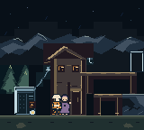
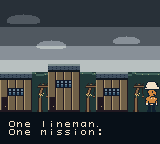

# 🎮 Lineman: After the Storm

[](https://modretro.com/products/chromatic)
[](https://www.gbstudio.dev/)
[](VERSION)
[](docs/PROJECT_PLAN.md)
[](docs/CAMPAIGN_PLAYTEST.md#verification)

A color-only Game Boy Color platformer about restoring power after a tropical
storm, built with GB Studio for the ModRetro Chromatic.

Current development version: **0.20.1-dev**. Storm Worker is the gameplay hero;
Neighborhood Hero introduces the story in the preserved storm cinematic. The
classic intro appearance remains available as a build option. See the
[hero variant guide](docs/HERO_VARIANTS.md) for native art, commands and evidence.




These are actual 160×144 emulator captures. The verified-test badge records the
latest documented local run, not a GitHub Actions result. Current cartridge
hardware acceptance remains open; historical release tags are separate from
this development build.

## 🌧️ The game

A tropical storm has knocked out the power on the hill. Lineman, the
village electrician, takes one work order at a time: reach the broken pole,
pick up the dangling cable end, carry it to the matching transformer and make
the line live. Repair the five-line chain for each household, then visit its door.

| Work order | Scene | Neighbor | What the power brings back |
| --- | --- | --- | --- |
| 1 | Storm Climb | Amara (Nigeria) | Her refrigerator |
| 2 | Wind Ridge | Hiroshi (Japan) | His oxygen concentrator |
| 3 | Signal Hill | Priya (India) | Her home workstation |
| 4 | Pine Hollow | Emil (Denmark), a kid | Dinner on the electric stove |

Flow: logo → storm cinematic → title (left idle, it replays the cinematic) →
Service Opening → a work-order card before each job → the storm report → title.

Hazards return you to a scene-specific checkpoint or safe entry; there are no
lives or game over. A dropped cable returns to its source pole, with first-time
guidance when that pole is in another scene.
Cracked boards creak and give way if you stand still on them, wind gusts and
live arcs fire on a timer, and hidden cables only show a brief spark before
they arc. Each neighbor speaks with their own name and voice pitch.

## 🕹️ Controls

| Input | Action |
| --- | --- |
| D-pad | Walk |
| A | Jump (short taps for one-shelf rises) / close dialogue |
| Down + A | Drop through one one-way shelf per press |
| B | Interact: pick up, connect, talk; drop a carried cable away from interaction zones |
| START | Start from the title |
| A or START | Skip the cinematic |

## 🧱 Project layout

The game is **Lineman: After the Storm**. The existing `mr-cfe.gbsproj`
filename and `gb-mr-cfe` checkout paths are retained technical identifiers,
not the current game title.

```text
mr-cfe.gbsproj       GB Studio project descriptor
assets/              Backgrounds, sprites, music, sound effects
assets/engine/       Generated one-line engine overlay (B-07); never edit by hand
project/             Scenes, actors, palettes, settings, variables (generated JSON)
tools/               Contracts, generators and tests (the source of truth)
docs/                Plan, handoff, bug log, design and workflow notes
build/               Local build output (ignored by Git)
```

Everything under `project/` and the art in `assets/` is generated from the
contract modules in `tools/` (`climb.py`, `ridge.py`, `rosa.py`, `kiko.py`,
`intro.py`, `tickets.py`, `hazards.py`, `voices.py`, …). Edit the contract or
generator, regenerate, then run the tests; don't hand-edit generated output.
Code keys keep the neighbors' original names (`marta`, `tomas`, `rosa`,
`kiko`) so resource IDs stay stable.

## 🧰 Build and verification

Generators and tests use the managed toolchain Python (Pillow):

```sh
PY="$HOME/Library/Application Support/modretro-chromatic/toolchain/.local/pyboy-venv/bin/python"
"$PY" tools/make_project.py climb --verify        # one profile: generate + its tests
"$PY" -m unittest discover -s tools -p 'test_*.py' # full suite
```

Profiles: `opening`, `climb`, `ridge`, `rosa`, `kiko`, `intro`, `tickets`, `lab`.

Choose the intro hero with `--intro-hero neighborhood` (default) or
`--intro-hero classic` to preserve the original appearance:

```sh
"$PY" tools/make_project.py intro --intro-hero neighborhood --verify
```
The separate `neighborhood_hero` sprite is retained for future story/map scenes.

Prefer the **ModRetro Chromatic MCP** for ROM builds, headless emulator checks,
the browser preview, streaming to the Chromatic and flashing the cartridge (see
[MCP toolkit](docs/MCP_TOOLKIT.md)). For a local CLI build, use a temporary
build directory whose path does not contain `src`:

```sh
TS="$HOME/Library/Application Support/modretro-chromatic/toolchain/.local/vendor/gb-studio"
CLI="$TS/out/cli/gb-studio-cli.js"
TMPDIR="$(getconf DARWIN_USER_TEMP_DIR)gbsb-cfe" \
  node "$CLI" -v make:rom ./mr-cfe.gbsproj build/rom/lineman.gbc
```

Test ROMs that start in a specific scene use
`tools/make_intro_scene.py --test-start SCENE_ID X Y DIRECTION`; restore
`project/settings.gbsres` before a release build and never commit the override.

## 📚 Useful docs

- [Hero variants, regeneration and native verification](docs/HERO_VARIANTS.md)
- [Latest hero implementation summary](docs/SESSION_SUMMARY_2026-11-07_HEROES.md)
- [Master project plan and progress log](docs/PROJECT_PLAN.md)
- [Session handoff: current state and next steps](docs/HANDOFF.md)
- [Bug log](docs/BUGS.md)
- [Design options awaiting decisions](docs/DESIGN_OPTIONS.md)
- [Reusable MCP toolkit and verification workflows](docs/MCP_TOOLKIT.md)
- [Platformer redesign brief](docs/redesign-brief.md)
- [Action-climb acceptance matrix](docs/action-climb-acceptance.md)
- [Git, SemVer and stable-tag workflow](docs/GIT_WORKFLOW.md)

## 🏷️ Versioning and collaboration

The version is in [`VERSION`](VERSION) (SemVer, pre-1.0) and is baked into the
title screen. Each release gets a `vX.Y.Z` tag; `stable` marks the latest one
approved on the cart. The repository is hosted at
[abarberenaCPDS/gbc-lineman](https://github.com/abarberenaCPDS/gbc-lineman); `main`
contains the merged work. Use a separate branch/worktree for changes and one-line
Conventional Commits. See [GIT_WORKFLOW](docs/GIT_WORKFLOW.md).
