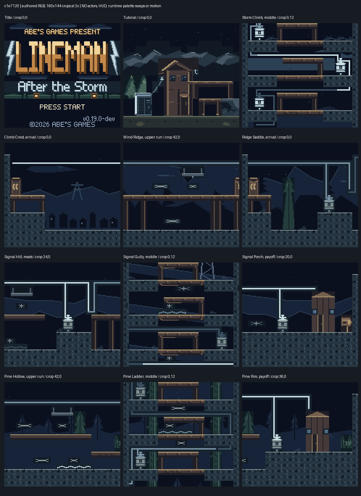
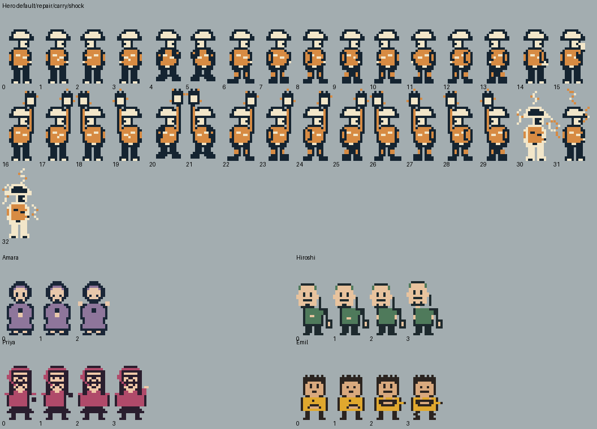

# Lineman: After the Storm — multidisciplinary experience review

Date: 2026-11-03. Baseline: `c1e7120`, version `0.19.0-dev`.

**Implementation update (2026-11-03):** Abe approved implementing this advice in a
sibling worktree. The recommended feedback-and-flow prototype is implemented on
`feat/experience-feedback` in `../gb-mr-cfe-experience`. See the implementation
record below. The original advisory analysis remains the baseline; its statements
that nothing is approved or implemented describe the earlier review, not current status.

## Objective

Improve the gaming experience through coordinated story, creative, script,
storyboard, character, background, color, music, arrangement, editing, and sound
design advice. This is an advisory review for Abe, not authorization to implement
the proposals. Preserve the accepted intro synchronization, art direction, repair
loop, and recent recovery/landing fixes unless new evidence supports changing them.

## Recommendation

Keep the game's identity: a capable local lineman restores a connected grid for
four people with ordinary, tangible needs. The accepted art, nine-shot intro,
music synchronization, cable-carry loop, and varied ascent/crossing/descent routes
are the foundation. The strongest next step is **clearer, more satisfying feedback
with fewer interruptions**, rather than more hazards, longer levels, or a replacement
soundtrack.

Start with a small feedback-and-flow prototype: attribute Amara's reward, make
Hiroshi's mandatory payoff acknowledge his oxygen machine, explain the first
cross-scene cable loss, and test a single intentional damage sound. Then compare
routine repairs with less modal text. Evaluate each change separately before
combining it. Nothing below has been implemented by this review.

## Review team and model choices

All fourteen subagents completed their assigned advice. Every role received the
explicit override shown below; at most five ran concurrently. Supervisors read
the relevant worker reports, and main checked source claims and reconciled conflicts.

| Role | Model override | Contribution |
| --- | --- | --- |
| Story editor | `gpt-6-astra`, high | Stakes, attribution, character arcs and ending |
| Creative consultant | `gpt-6-astra`, high | Repair loop, recovery, flow and scope |
| Script supervisor | `gpt-6-luna`, medium | Names, prompts, repeated dialogue and continuity |
| Storyboard supervisor | `gpt-6-astra`, high | Integrated staging and validation sequence |
| Storyboard worker: intro and agency | `gpt-6.1-terra`, high | Nine story beats, title and first repair |
| Storyboard worker: gameplay and payoffs | `gpt-6.1-terra`, high | One micro-storyboard per neighbor |
| Character designer | `gpt-6.1-terra`, high | Silhouettes, carry pose, gestures and shock |
| Background designer | `gpt-6.1-terra`, high | Route staging, landmarks and home identity |
| Color designer | `gpt-6.1-terra`, high | Visual hierarchy, state cues and color pipeline |
| Music supervisor | `gpt-6-astra`, high | Unified cue strategy and sound priorities |
| Music designer | `gpt-6.1-sol`, high | Motifs, completion and soundtrack fatigue |
| Orchestration and arrangement specialist | `gpt-6.1-sol`, high | Four-channel voicing, density and loop seam |
| Music editor | `gpt-6-luna`, medium | Cue continuity, transitions and timing |
| SFX designer | `gpt-6.1-sol`, high | Action/danger signals, arbitration and retry comfort |

Astra handled cross-disciplinary judgments; Terra handled visual/staging review;
Sol handled score and audio-engine detail; Luna handled bounded continuity audits.
Sonnet was not exposed in the available override catalog, so Terra filled the
visual roles. This is a capability-based allocation, not a measured cost comparison.

## Evidence and limits

- **Source:** current contracts, generators, scene resources, dialogue, active cue
  references, actual WAV metadata, and both active UGE scores. Audio specialists
  checked decoded binary score cells/orders against their generators.
- **Static visual:** character designer inspected one palette-mapped sprite sheet.
  Background and color designers each inspected the same current authored-RGB
  viewport sheet once. The reference sheets below are not emulator captures.
- **Previous native evidence:** the accepted handoff records carry/hit/retrieval,
  gully descent, recovery jumps, internal music continuation, and sampled OAM.
  Those checks were not rerun for this advisory review. Its recorded 490 passing
  tests are baseline evidence, not proof that these new proposals work.
- **Not assessed here:** fresh listening, full-game play, player comprehension,
  browser feel, every hazard phase/camera position, or physical-device quality.
  All workers could call MCP status, but their isolated sessions had no selected
  project or active emulator; none claimed to play or listen.

**Priority:** P1 = first prototype or investigation; P2 = next candidate; P3 =
optional taste/polish. **Effort:** S = a contained source/script/art adjustment;
M = coordinated changes and runtime verification; L = broader system/content work.
These are relative estimates, not schedules. A priority is not a finding that the
accepted game is broken.

## Prioritized proposals

| ID | Proposal | Evidence/confidence | Benefit to the player | Priority / effort | Acceptance check |
| --- | --- | --- | --- | --- | --- |
| R1 | Name/voice Amara's personal reward; connect Hiroshi's required reward to his stated need | Confirmed source inconsistency/emphasis gap; impact untested | Understand who benefited and why the job mattered | P1 / S | Named three-line speech, separate narrated CLOSED; correct device state; no repeat on re-entry |
| R2 | Make the first cross-scene cable loss explain where the cable returned | Return rule confirmed; confusion is a hypothesis | Spend retries solving the route rather than searching empty-handed | P1 / S | Fresh players identify the original pole/return exit; same-scene losses do not give misleading directions |
| R3 | Test one deliberate damage gesture instead of back-to-back death/shock requests | Source/compiler replacement risk confirmed; audible truncation unobserved | A clear consequence with less competing audio on retries | P1 / S | One complete cue per hit across ten retries; respawn timing and music/channel recovery preserved |
| R4 | Reduce routine success dialogue after teaching the action; shorten Emil's repeated briefing | Repeated modal pages confirmed; fatigue untested | Longer uninterrupted movement and repair sequences | P2 / M | Compare a full job; fewer dismissals without losing carry/repair recognition or exceptional explanations |
| R5 | Test hazard-marker recognition, then one nearby audio warning if needed | Marks/warning phases exist; interpretation/detection untested | Recognize a dangerous lane before committing to a jump | P1 investigation, P2 changes / M | Native warning/active/rest views, with music and muted; overlapping warnings do not produce spam |
| R6 | Pair existing visual motifs at confusing cross-scene wire handoffs | Height/edge changes confirmed; disorientation untested | Recognize that the same cable/grid continues | P2 / M | Paired departure/arrival views and a fresh carry traversal show the correct onward route |
| R7 | Distinguish household completion from an ordinary connection | Shared connect sound confirmed; emotional effect is taste | Feel a completed household as a milestone | P2 / M | Compare one short replacement sting and clear device reveal; once per home, no new input delay |
| R8 | Pilot one repaired span becoming persistently safe after its final repair | Current arc activation rule confirmed; new rule is a design experiment | See completed work improve the return route | P2 / M | First-pass challenge unchanged; post-repair/re-entry collisions stay disabled; result is visually understandable |
| R9 | Test carrying, powered-state and resident recognition without color or text alone | Static character/state evidence; runtime recognition untested | Read possession, progress and people quickly | P2 / M | Native 1× views in both directions and representative grayscale; preserve existing sprite/palette budgets |
| R10 | Audition a resolved ending reprise and, only if needed, one lighter gameplay arrangement | Current cue/score structure confirmed; preference untested | Stronger closure and comfortable sustained listening | P2 ending, P3 arrangement / S–M | Baseline/candidate listening; preserve intro timing, loop continuity and SFX recognition |

### 1. Story editor

The story's strongest choice is its practical scale: food, breathing equipment,
work and a warm meal. Keep the hero's professional competence and the neighbors'
individual personalities.

Amara's mandatory reward is currently raw text, unlike her named conversations.
Use her speaker wrapper for the personal page and leave CLOSED as narration.
Hiroshi's device already starts, but the mandatory line says “Lights are on. / I
stayed calm.” A direct acknowledgment would fulfill the medical dispatch without
requiring another conversation. Source: [Amara reward](../tools/make_crest_scene.py#L187),
[Hiroshi reward](../tools/make_ridge_scene.py#L345), [dispatches/report](../tools/tickets.py#L69).

Possible wording, checked against the existing 17-character-per-line limit:

```text
Amara:               Hiroshi:
Power's back!        It hums again.
My fridge hums.      Breathing easier.
```

Emil's dispatch and three entry pages repeat the dinner motivation. Trial keeping
one actionable entry page. A shared-soup ending could connect the neighbors, but
it is optional taste; prioritize clarity and pacing before rewriting accepted
character voices. Avoid adding timers to Hiroshi's need merely to manufacture urgency.

### 2. Creative consultant

Preserve deliberate B interactions, one cable per trip, persistent repairs and
advancing checkpoints. The four route shapes already provide progression.

The most useful recovery experiment keeps the accepted cable-return rule and adds
only a once-per-job explanation after the first cross-scene loss. For example:
“Cable at pole.” / “Back to the climb”. Use the actual upstream scene for each job.
Measure time spent understanding the loss separately from time spent replaying
the challenge. Source: [drop/checkpoint rules](../tools/grid_chain.py#L473),
[cross-scene fifth line](../tools/climb.py#L140).

Routine pickups and connections currently use modal dialogue. Trial retaining
the first teaching message, errors, “fixed but upstream dark,” and final direction
to the neighbor, while letting later successes use existing Carry/HUD/wire/SFX
feedback. Verify that an old dismissal press cannot become an unintended jump.
Source: [pickup/connection](../tools/grid_chain.py#L639).

The safe-span pilot would make repair change traversal, not merely counters.
It is a new design choice, not a bug fix: the crest arc currently activates after
four upstream repairs. Do not apply globally without a before/after playtest.
Source: [crest span](../tools/climb.py#L567), [arc behavior](../tools/grid_chain.py#L840).
Defer collectible branches and additional difficulty until retry clarity is understood.

### 3. Script supervisor

Keep speaker names, compact lines and differentiated concerns. Audit the sequence
of nearby talk, mandatory reward and CLOSED so each says something useful rather
than paraphrasing the previous page. Priya's work/email setup and payoff are
compatible; any rewrite is a clarity/taste choice, not a continuity repair.

Clarify context-sensitive B instructions only where testing shows a need:
“B: take cable” / “B: connect at box” fits the current limit. A same-page
“D-pad: move” cue is preferable to another tutorial briefing. Source:
[opening controls](../tools/make_opening_scene.py#L270),
[first-job controls](../tools/make_climb_scene.py#L751),
[speaker wrappers](../tools/voices.py#L21).

**Main's correction:** the reviewer's `MR CFE` branding concern does not establish
a visible defect. `TITLE_ROWS["MR CFE"]` is an internal layout key; the renderer's
[WORDMARK is already LINEMAN](../tools/make_intro_art.py#L93). Legacy character
keys and unused village text also are not player-visible naming errors. Do not
rename stable identifiers for this review. Proposed dialogue must be validated,
not copied blindly from reviewer examples.

### 4. Storyboard supervisor

The integrated journey is **understand the outage → act → read the route → carry
through a challenge → see the device respond → hear the person's payoff → close
the dispatch**. Keep the nine-shot clock and existing geometry; redistribute
attention rather than extend the cinematic.

Gameplay's top HUD and bottom dialogue can hide the very device a reward is
trying to celebrate. First capture each current payoff. If the device is masked,
trial a brief device-before-speech beat using existing states; do not assume a
camera pan, another overlay or added actor is necessary. Source:
[intro caption region](../tools/intro.py#L216),
[gameplay dialogue/HUD](../tools/make_ridge_scene.py#L194).

The supervisor favors a same-page movement cue, Amara's attribution fix, Hiroshi's
specific payoff, matched existing transition motifs only when needed, and shorter
Emil briefing. It defers the shared-soup rewrite and rejects extra intro shots or
retiming the accepted synchronization.

### 5. Storyboard worker — intro and first agency

Keep all nine existing beats and their four-bar musical sections. This plan
primarily defines what first-time comprehension should be tested, not new footage.
Source: [shots](../tools/intro.py#L262), [timeline](../tools/make_intro_scene.py#L380).

| Beat | Preserve | Experience question / candidate |
| --- | --- | --- |
| 1. Dusk | Familiar quiet hill | Does the place register before the loss? |
| 2. Storm | Rain and palette change at the section boundary | Is the threat apparent before lightning? |
| 3. Lightning | Accepted double strike, shake and thunder timing | Do thunder and percussion remain distinguishable? Requires listening. |
| 4. Outage | Struck-first poles and staggered dark windows | Can viewers explain strike → fallen lines → loss of power? |
| 5. Morning | Clearer sky, windows still dark | Is the remaining problem apparent? |
| 6–7. Human stakes | Food, medical equipment and internet | Are both caption sections recalled without slowing the sequence? |
| 8. Lineman | Hero24 walk inside its existing shot budget | Does the arrival turn aftermath into intent? |
| 9. Mission | “Bring the power / back home.” | Can a first-time viewer state the goal before controls? |
| Title → tutorial | START and immediate panel instruction | Can the player approach and repair independently? Trial same-page movement cue if needed. |

The worker's inspected grayscale intro sheet was historical, so its visual
composition impressions were excluded from current-art conclusions. Current title
colors were separately inspected by the color designer.

### 6. Storyboard worker — four gameplay micro-storyboards

| Job | Proposed attention sequence | Test before changing staging |
| --- | --- | --- |
| Amara | Fridge dispatch → ascent → cable 5 → crest continuation → transformer → saved food | On each side of the crest transition, identify onward direction and safe landing with cable in hand |
| Hiroshi | Medical dispatch → ridge/saddle carries → final transformer → concentrator → personal relief | Hero, Hiroshi and device readable together; once-only reward and re-entry remain correct |
| Priya | Deadline → hill → controlled gully descent → porch handoff → workstation → relief | Matched existing sign/wire cue survives vertical-to-horizontal change; cable 5 reaches its box |
| Emil | One actionable briefing → hollow/ladder ascent → rim carry → stove → soup invitation → report | Stove state visible before text covers it; reduced briefing does not remove the objective |

Source: [links](../tools/scene_links.py#L106), [Priya lines](../tools/rosa.py#L185),
[Emil lines](../tools/kiko.py#L325), [device payoff](../tools/make_kiko_scene.py#L655).
No new art, camera motion or sound layer is implied by these sequences.

### 7. Character designer

The static sheet supports retaining the helmet/orange-jacket hero, 24px adults,
20px Emil, overhead cable silhouette, and individual props. These give the small
cast recognizable shapes; do not replace them with cultural shorthand.

Test Carry at native 1× in both directions, during jumps and cross-scene arrival.
If the plug/arm/helmet merge, redistribute existing pixels within the current
16×32 canvas rather than add an actor or palette. The neutral sheet does not
prove in-scene visibility. Source: [carry art](../tools/make_opening_characters.py#L76),
[carry restoration](../tools/grid_chain.py#L581).

Check waiting versus powered gestures around actual dialogue windows. Hiroshi's
shoulder/head relaxation, Priya's gesture and Emil's raised bowl can carry more
emotion than extra text if they read clearly. Test shock in motion for legibility
and comfort before changing its inverted frames, shake or hold.

**Scope correction:** Pine Ladder is a jump-through-shelf shaft. An existing
sprite “climb” slot is not evidence of an active ladder-climbing verb. Defer the
worker's dedicated ladder-pose idea unless a real mechanic needing it is introduced.

### 8. Background designer

The current RGB crops support keeping thin warm landing edges, recessed blue-gray
terrain, the crest's town reveal, gully lashings/runoff and Pine Ladder's trunks.
The reviewer withdrew its initial broad “differentiate the shafts” proposal after
seeing that the two settings already look distinct.

The better question is what the small floating cross-marked hazard placards mean
with animated actors present. Investigate Wind Ridge x47–54 and Pine Hollow
x44–52 before adding marks or decoration. If recognition fails, give caution
marks one consistent silhouette distinct from whip hardware. Source:
[ridge placards](../tools/make_ridge_art.py#L471),
[pine placards](../tools/make_kiko_art.py#L369).

Priya's and Emil's similar porch facades could each receive one restrained
architectural signature, using current palettes. This is optional destination
recognition polish. Existing crest/saddle exit markers already read in the sheet;
test paired wire-port motifs only at handoffs that players misunderstand.
Source: [Priya porch](../tools/make_rosa_art.py#L433),
[Emil porch](../tools/make_kiko_art.py#L339), [wire ports](../tools/rosa.py#L283).

### 9. Color designer

Preserve the amber title hierarchy, subdued distant scenery, brighter shelf edges,
and cold-to-warm restoration language. Do not globally brighten accepted art.

Hidden cables have a short safe warning before the damaging arc. Test whether
that animated cue separates from decorative pale marks, in motion and grayscale;
the background sheet cannot answer it. If needed, strengthen silhouette/rhythm
before changing timings or adding colors. Source: [hazard warning](../tools/hazards.py#L80).

Dead/live source wire colors already have a substantial luminance difference
(`3D5364` ≈0.081, `38C8D8` ≈0.471 in relative sRGB luminance). That is not an
accessibility verdict. A powered transformer shape/indicator could supplement
color and the existing LINE count, but must not look like a damaging arc. Check
intermediate repair stages, not only all-dead/all-live. Source:
[chain palettes](../tools/climb.py#L205).

Any candidate must survive actual CGB 5-bit conversion, manual tile assignments,
the distinct OBJ color mapping, three opaque sprite colors, and reserved BG UI
slot 7. Assess character/door separation in actor-inclusive native views and on
the physical display. Source: [color pipeline](MCP_TOOLKIT.md#native-color-pitfalls-verified-with-gb-studio-432).

### 10. Music supervisor

**Keep the accepted music. Improve signal priority before commissioning more.**
Proposed priority is damage → nearby actionable warning → action/completion
confirmation → decorative blips/percussion. This is a proposed arbitration policy,
not an existing dynamic mixer.

First listen to two complete gameplay loops with pickup, connection, hit, dialogue
and an internal edge at different musical positions. Compare the current hit with
one consolidated damage gesture. Only then try one serialized, nearby warning
or one short home-completion signature. Keep visual warnings sufficient for muted play.

The supervisor prefers a ≤300ms E–G–B signature **replacing** the home's ordinary
connect effect before trying the designer's four-bar replacement bed. Preserve
continuous gameplay music through internal edges and inherited dispatch music.
Reserve the intro's D-major identity for a possible resolved ending reprise.
Source: [gameplay hook](../tools/compose_climb.py#L28),
[home effect](../tools/make_crest_scene.py#L187), [report music](../tools/make_ticket_scene.py#L179).

### 11. Music designer

Both decoded active UGE scores match the current generator notes/effects/orders.
The intro moves from D-minor threat through sparse aftermath into a D-major hero
arrival. Gameplay's E-minor hook already includes a quieter bridge; neither
needs replacement merely because further review was requested.

Three optional prototypes: a household completion answer built from the gameplay
hook; one sparser accompaniment variant for a later job if sustained listening
reveals fatigue; a final heroic reprise rather than returning straight to the
minor opening after victory. Source: [intro B](../tools/compose_intro.py#L137),
[gameplay arrangement](../tools/compose_climb.py#L64).

The four-bar home bed is a larger alternative to the supervisor's short effect,
not an additional layer to stack on top. Likewise, later-job variation is not a
request for four new themes. Compare one candidate at a time and retain the
original if players prefer it.

### 12. Orchestration and arrangement specialist

Both scores use pulse lead, pulse accompaniment, half-level wave bass and noise
percussion. WAV effects borrow channel 3, so lower effect volume alone cannot
prevent a bass interruption. The arranger verified this in the installed compiler
and audio manager; audible severity remains unmeasured.

Concrete, small score experiments, deferred until the audio baseline is heard:

- **Harmonic support during effects:** put E4/C4/G4/D4 roots at rows 2/18/34/50 of
  gameplay accompaniment pattern 100, retaining later tones, volumes and cuts.
- **Bridge separation:** lower C5/E5 accompaniment to C4/E4 in bars 1/3 of pattern
  104, leaving rhythm and volume unchanged. Test for bass overlap rather than
  assuming lower register is automatically better.
- **Loop seam:** audition holding the final wave note across pattern 207's row-63
  cut into the opening E3. The current six-tick rest is about 94ms at 64Hz; it may
  be a useful breath, so retain whichever listeners prefer.

Source: [chords/phrases](../tools/compose_climb.py#L28),
[per-channel writing](../tools/compose_climb.py#L64),
[instrument refinement](../tools/compose_climb.py#L123).
An optional mission-pattern note reduction was also proposed, but the supervisor
defers it: accepted cinematic sync and phrasing are a lower-priority target.

### 13. Music editor

Document cue intent before changing it. Current source flow is:

| Moment | Current behavior to preserve or deliberately audition |
| --- | --- |
| Logo | Silent |
| Story | Theme B restarts at shot 1 each pass |
| Story → title, including skip | Existing B continues; title idle replay returns to a fresh story start |
| Tutorial | Starts the gameplay track |
| Work order | Inherits the current music |
| Fresh job entry | Requests the gameplay cue once via the ticket gate |
| Internal job edge | Continues the job music without a play event |
| Report pages | Inherit gameplay music |
| Report exit | Victory effect, then theme B request before title |

Source: [story/title](../tools/make_intro_scene.py#L433),
[fresh-start gate](../tools/grid_chain.py#L543),
[report](../tools/make_ticket_scene.py#L179).

The **64Hz music clock** matters: intro tpr4 ×64 rows gives 4 seconds per section,
36 seconds for nine; gameplay tpr6 ×8×64 rows gives **48 seconds**. The old 51.4s
comment/decoder VBlank estimate is not the active runtime clock. This warrants
documentation accuracy, not a tempo change. Preserve 239-frame shot scheduling
and the measured five-frame overhead compensation. Source:
[timing contract](../tools/intro.py#L131), [old estimate](../tools/compose_climb.py#L98).

Trace start, skip, title replay, report/victory and one complete edge cycle per
job. Compare pointer/order/row and listen: pointer continuity alone cannot prove
a pleasant transition or an untruncated effect.

### 14. SFX designer

The current active WAV effects include pickup (92ms), connect (200ms), death
(300ms), shock (400ms) and victory (400ms). Source files are mono unsigned
8-bit/8000Hz; compiler playback is reduced. Peak/RMS statistics were inspected,
but are not perceived-loudness judgments. Place/sparkle/jump/cut references found
in legacy content are not evidence that these play during the active route.
Source: [sound sources](../tools/make_sfx.py#L24),
[pickup refinement](../tools/make_repair_sfx.py#L19).

The strongest risk is the immediate death→shock sequence. The installed WAV event
compiler ignores `wait`, and equal-priority sound requests may replace one another.
Investigate a single 120–180ms crack/fall gesture while retaining respawn behavior.
Source: [hit sequence](../tools/make_climb_scene.py#L537),
[shock request](../tools/shock.py#L34). This is a source-supported truncation risk,
not a newly heard defect.

Hidden cable, gust and whip warning phases are silent; board code has an optional
sound hook rather than a universal audible warning. Trial one 30–50ms electrical
doublet, breath or woody click only at a visible nearby warning onset. Serialize
requests, suppress during damage/dialogue, and compare against silent baseline.
Do not add an off-screen chorus. Optional later changes are a quiet voluntary-drop
cue and blips on/off, preserving speaker names and narrator restoration. Source:
[warning scripts](../tools/hazards.py#L216), [voices](../tools/voices.py#L21).

## Visual reference sheets

These are review references, not proposed replacement assets or gameplay captures.
The background sheet uses current generator RGB functions at baseline `c1e7120`:
160×144 crops enlarged 2×. It omits actors, HUD, runtime palette swaps and motion.
The character sheet uses existing frames mapped through their source palettes
against neutral backgrounds; it does not establish in-scene contrast.





## Conflicts resolved and ideas deferred

| Competing advice or concern | Consolidated decision |
| --- | --- |
| More onboarding versus fewer interruptions | Trial a same-page movement cue; do not add another briefing by default |
| Four-bar house music versus short completion effect | Test one short replacement effect first; keep the four-bar bed as an alternative |
| Add warning audio versus preserve bass/avoid cue spam | Fix/test damage arbitration first; trial one nearby warning with serialization |
| More environmental detail versus route clarity | Preserve the existing quiet hierarchy; strengthen only a misunderstood cue |
| Stronger shaft identities | Current RGB review already distinguishes gully and pine; broad redesign dropped |
| More visual restoration feedback | Existing window/device changes first need actor-inclusive before/after assessment |
| MR CFE internal title key | No visible branding bug established; renderer already draws LINEMAN |
| Dedicated ladder-climb pose | Defer: Pine Ladder is currently shelf-jump traversal, not a ladder-climbing mechanic |
| Story/script examples | Keep only line-length-validated wording; old resource keys remain stable |
| Reworked intro phrasing, new themes, collectibles | Defer until feedback clarity, recovery and full-session pacing have evidence |

## Proposed validation and decision sequence

1. **Capture the current experience.** One fresh player's complete job, one
   cross-scene hit/recovery, all four home payoffs, and two 48-second music loops
   with representative actions. Record confusion, dismissals, retry time and cue
   recognition, rather than interpreting test counts as enjoyment.
2. **Pilot R1/R2/R3 separately.** Check generated text/speaker restoration and
   once-only behavior; observe correct cable retrieval; listen for a complete hit
   cue with restored music channels. Keep geometry, difficulty and accepted sync.
3. **Compare flow and hazard readability.** Trial fewer routine pages, then a
   selected warning/marker change if baseline recognition is weak. Record whether
   players still know what they carry, what powered, and where to go.
4. **Audition payoffs and arrangement.** Compare a short completion signature and
   ending reprise; only then investigate fatigue/register/loop-seam changes.
   Use actual gameplay and physical-device speakers as well as headphones.
5. **Run implementation gates only for selected candidates.** Deterministic
   regeneration, ≤17-character dialogue lines, correct speaker restoration,
   logo-start restoration, tile/palette checks, exact-ROM gameplay/re-entry,
   music order/row traces, and sampled OAM. Follow with human browser and hardware
   review; static sheets do not replace those.

For a small exploratory trial, aim for four of five fresh players to find the
original pole/exit after the recovery cue without coaching, and to distinguish
carry/connected/damaged state. Compare routine dismissal counts and time to regain
control. These are proposed pilot targets, not statistical proof or automatic
release gates. A smaller one-change prototype is preferable to bundling all ten
ideas and losing the ability to tell what helped.

### Decisions for Abe after reading

- Start with the recommended feedback-and-flow prototype, or keep this report as
  a backlog for later?
- Keep the accepted cable-return rule with clearer guidance (recommended), or
  separately explore a more forgiving retry rule?
- Keep current music and test signal/completion changes first (recommended), or
  prioritize a distinct musical identity per job despite the larger scope?
- Is shared soup a fitting ending detail, or should each neighbor's payoff remain
  independent? This is optional and can wait.

No proposal is approved merely by appearing here. This review changed documentation
and reference images only; game resources, VERSION, existing tags and web preview
were left untouched. Individual reviewer working notes are retained locally in
`build/review-2026-11-03/`; the substantive advice and corrections are consolidated here.


## Implementation record — 2026-11-03

Abe: “I like the proposal. let's implement them now as advise, use a sibling git
worktree and branch.” Followed the recommendation to deliver a bounded prototype
before making recognition- or taste-dependent changes across all ten proposals.

| Proposal | Delivered / decision |
| --- | --- |
| R1 | Amara's three-line speech uses her name and voice, restores narration before separate CLOSED. Hiroshi now says “It hums again. / Breathing easier.” Existing once-only and device gates retained. |
| R2 | First remote cable loss per job queues the cable's source scene and shows “Cable at pole. / Back to / <scene>.” after safe respawn. Local losses stay quiet; voluntary drops retain their explicit message and get remote guidance when needed. Vars 50/51 survive internal edges and reset only at a fresh job. |
| R3 | Every game/lab hit requests the existing shock WAV once, removing the immediately preceding death request. Shock state, 12-frame shake, 12-frame hold, cable return and checkpoint ordering retained. No new damage-warning sound. |
| R4 | First pickup and first ordinary powered connection teach once per job (vars 52/53); subsequent routine successes use Carry/HUD/wires/SFX. Errors, upstream-dark explanations and final neighbor directions remain modal. Emil's three entry pages become one actionable page; opening adds movement on the existing controls page. |
| R7 | All four once-only home rewards replace ordinary connect with a deterministic 220 ms E5-G5-B5 cue, generated by `make_completion_sfx.py`. Ordinary boxes retain connect. No extra wait or music request. This is a listening candidate, not a taste verdict. |
| R5 / R6 / R9 | Recognition investigations remain human checks: muted hazard recognition, paired handoff orientation, Carry/resident/device recognition at 1x and in grayscale. No reported confusion yet justifies extra marks, art or warning audio. Accepted art and runtime object budgets stay intact. |
| R8 | Safe-span experiment remains a subsequent controlled trial: the advice calls for a before/after playtest and a visually understandable safety change. Current arc rules retained in this prototype to isolate feedback/retry effects. |
| R10 | Ending reprise and lighter arrangement remain subsequent auditions. Current music, intro clock and transitions retained; baseline/candidate listening and device-speaker assessment are still needed. |

Implementation checks:

- All **502 tests pass** under the managed Python, including recovery/teaching
  branch execution, all four home device/reward/voice/once-only paths, and exactly
  one shock request per generated hazard-scene hit. This is source evidence.
- All eight profiles regenerated. A second pass left **642 asset/resource files
  byte-identical**, including the new WAV. No changes to existing backgrounds,
  sprites, music, geometry, engine overlay, VERSION or existing tags.
- Strong MCP refresh + inspection: **0 errors / 0 warnings / 0 info**;
  20 scenes, 164 actors, 97 triggers, 127 palettes, 95 assets, 50 variables.
- Final native `build/rom/lineman-experience.gbc`: 524288 bytes, valid GBC header,
  SHA-256 `8ee9a6765da62177d59f35d5fb675727bc9be556c82358388fed30f7320dd0fd`.
  Exact-ROM source debug confirms **Abe's Games Logo at frame 120**. No test start
  or fixture remains in production resources. CLI emitted only upstream DEP0190.
- Web `build/web-experience`: 524288-byte ROM,
  SHA-256 `3f53f857643361b225c252dad13f2d0859d497ce89959666a5e8a7c684feb814`.
  It is a separate web build, not the native-ROM identity above.

Native checks used temporary generator wrappers with seeded progress and a test
start. They exercise production scripts but are not full-job completions:

- **Recovery** ROM `68c184d4...`, recording
  `artifacts/playtests/experience-recovery`, session
  `752181e329324c8bba59cd054fcb0701`, branch `branch-0001`, frames 180–1423.
  Remote hit clears carry 5→0, keeps line 5 dead, respawns onto the crest arrival,
  and displays the actual Storm Climb return hint (frame 270, shown=1/pending=0).
  Back exit reaches Storm Climb (515), original pole permits retrieval
  (710, carry=5), and a later local drop/re-pickup (1423) gives Carry/HUD without
  repeated pickup text. Internal return preserves the first four repaired-line
  flags; this fixture did not seed the HUD's repair count. Sampled peak OAM 7/line,
  zero over-limit lines. Failed navigation/dismissal attempts are retained too.
- **Amara** ROM `778cb709...`, recording `artifacts/playtests/experience-amara`,
  session `d1afabfcf46a465db1b4432f7cbcb9d6`, branch `branch-0001`.
  Named personal reward at frame 422, separate CLOSED at 623; leave/re-enter
  shows the HUD without reward repetition at 906. Home flag=1, chain=5.
  Sampled peak OAM 4/line, zero over-limit lines.

Main alone selected/built/played. Coding workers confirmed direct MCP status
access, but their isolated sessions reported no selection; they did not select
or claim MCP project verification. Main performed the project checks.

Current preview: http://127.0.0.1:56988/aac254e162594eccf2a143c73c41faeb4d9e65a2a2865320c3fa0ff5085c6a2e/

The built-in browser/Chrome automation host was unavailable. Abe reports Chrome
tabs, but no agent browser-play or listening verdict is claimed. Historical
`62832` refused connections at the final check; `54764` served HTTP 200 but is a
different listener. Neither old listener was replaced. The new candidate listener
is open and cached-export identity checked.

Before expanding this prototype, compare a full job's dismissal count and retry
clarity; listen to ten hit/recovery repetitions, the four home cues and two complete
48-second music loops with actions. Verify channel recovery, fresh-player return
directions, muted warnings, grayscale readability and physical hardware. Preserve
the accepted rule unless the evidence supports another trial. These human gates
remain open; test counts and sampled frames do not establish enjoyment or audio taste.
