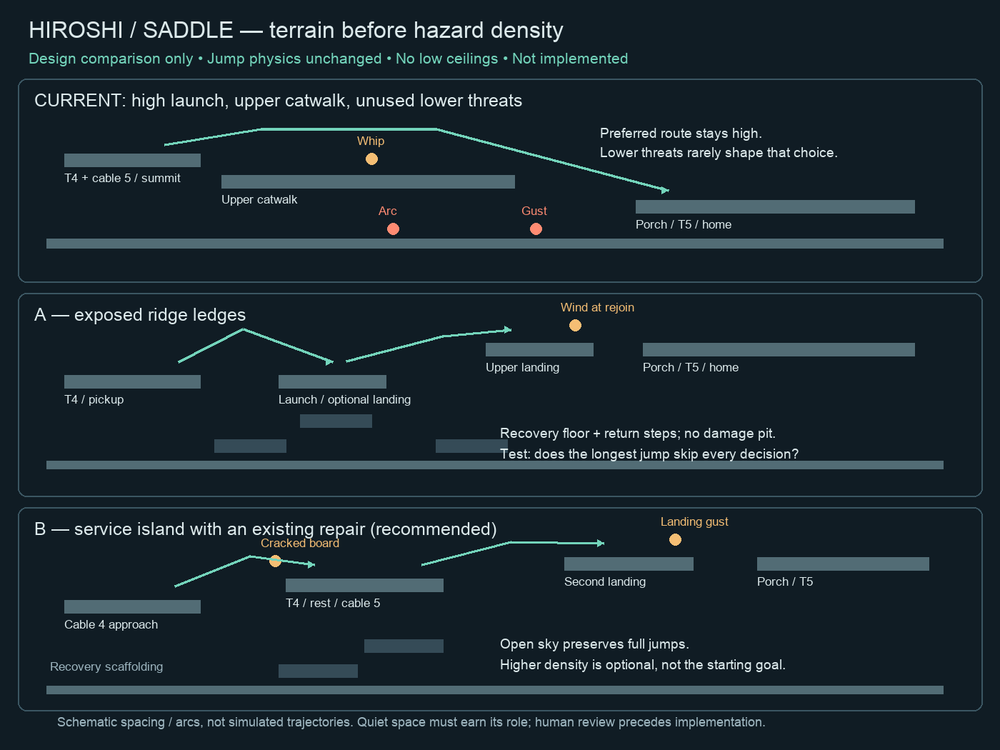

# First terrain proposal: Saddle's approach to Hiroshi

Planning artifact on `feat/terrain-design`, after the v0.21.0 release merge.
No gameplay resources, physics or production geometry changed in this step.

The diagram shows relationships, not simulated jump trajectories or pixel-exact
spacing. Current production is 64×18. Both candidates propose 64×36 with open
sky and ground surface27; left-half terrain translates down12 rows. This frame
is a proposal to provide headroom, not a decision to enlarge every mission.

## Current route

The summit rock spans32–37 at surface6. T4 is(33,5), its checkpoint(35,5), and
cable5 pickup(37,5). The long catwalk38–47 at surface9 leads toward porch50–62
at surface12. Upper whip43–44 competes with lower arc42–43 and gust47–49.
The common upper route makes the lower threats feel irrelevant. A useful
recovery floor does not need to damage the player simply to justify its area.

## A: exposed ridge ledges

Keep T4 and cable5 together on rock32–37 at surface18. Replace the long final
catwalk with one-way ledge40–43 at surface18 and ledge46–49 at surface15.
Porch50–62 is surface15; T5(54,14), checkpoint(56,14), Hiroshi(58,14), device(60,14).
A gust at chest13 over48–50 influences the landing/rejoin. Retire the redundant
lower arc and upper whip in this segment. Recovery floor27 has steps38–40 at24,
41–43 at21, and45–47 at24.

This is the smaller objective change. A long jump may legitimately skip the
first ledge. Native testing must determine whether it also makes the entire
crossing trivial; do not assume these coordinates force two decisions.

## B: service island with an existing repair — recommended

Keep the launch rock32–37 at surface18. Move existing T4 onto an island44–49
at surface18: T4(45,17), checkpoint(47,17), cable5 pickup(48,17). This gives the
middle area a work objective without adding a sixth repair.

Approach catwalk38–41 is surface18 with cracked boards38–40; gap42–43 leads to
the service island. Final landing catwalk50–53 and porch54–62 are surface15.
Proposed gust50–52 at chest13 affects that landing. T5(54,14), checkpoint(56,14),
Hiroshi(58,14), device(60,14), outgoing trigger(62,12,1,3).

Recovery floor27 uses steps38–40 at24 and41–43 at21 toward the approach. Beneath
the final landing, one-way recovery ledges50–53 at24 and21 return to the service
island in three-tile rises. The drawing condenses this scaffolding schematically.
All props, line routes, trigger bounds and arrival framing would need coordinated
updates in the isolated generator if this concept is selected.

Why B first: cable4 earns its longer crossing by reaching a repair pad; cable5
becomes the final connection to the house. Jumping remains free. The middle area
has a clear purpose instead of existing only to slow or damage the player.
Tradeoff: the final cable may feel too short, and the transition from island to
landing needs enough pickup/braking space. These are open questions, not fixes
already proved by the diagram.

## Before implementation

Review the terrain character and preferred candidate with Abe. Then measure the
actual unchanged jump envelope against its coordinates. Explicitly test:

- Full-held and short-tap jumps, including the easiest direct route.
- Moving pickup, neutral braking and safe warning visibility before commitment.
- Falling from each gap and returning without a tedious detour or trapped cable.
- Reverse travel and scene transition orientation.
- Full Carry headroom above the highest reachable surface and HUD.

Do not add low roofs to correct a failed shortcut test. Adjust route purpose,
landing arrangement or the repair destination. Keep the existing five repairs.
The hardware release remains v0.21.0; this proposal is not installed on the cart.

## Town hub remains pending

The fixed dispatch neighborhood map is in v0.21.0. The walkable top-down hub is
prepared only as isolated `make_dispatch_hub.py` / `test_dispatch_hub.py` source.
It still needs generation, a build, directional movement/door/job-order tests,
persistent restored-light checks and human play. Planned order: review this
terrain concept, validate one selected route experiment, then build/play the hub.
The full campaign playthrough can inform both while these proposals are reviewed.
