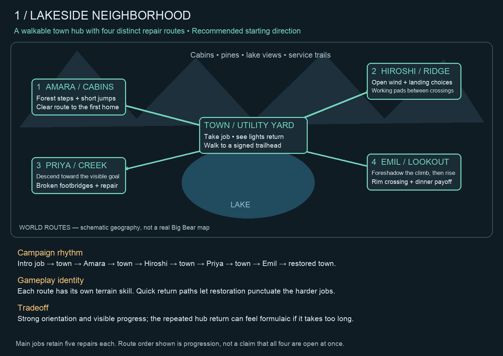
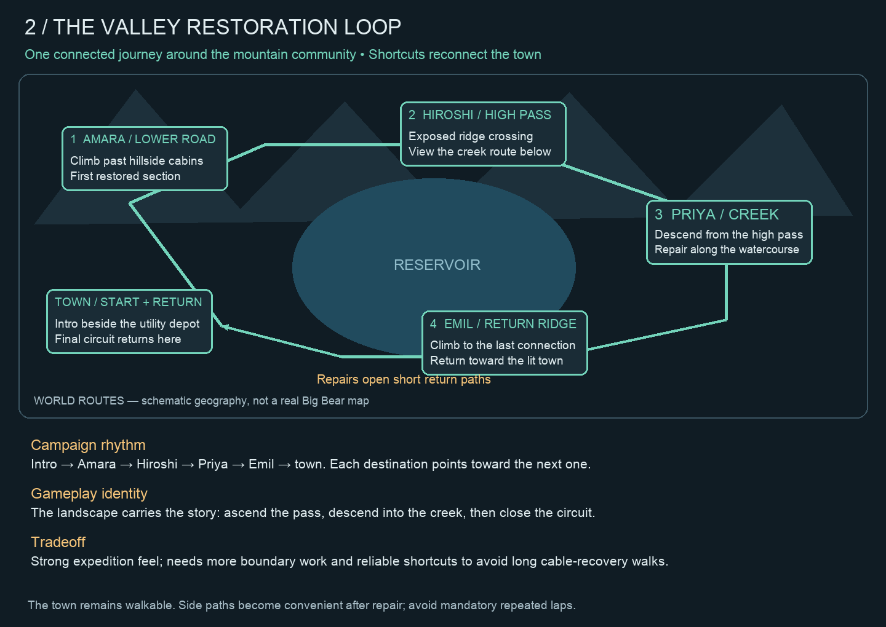
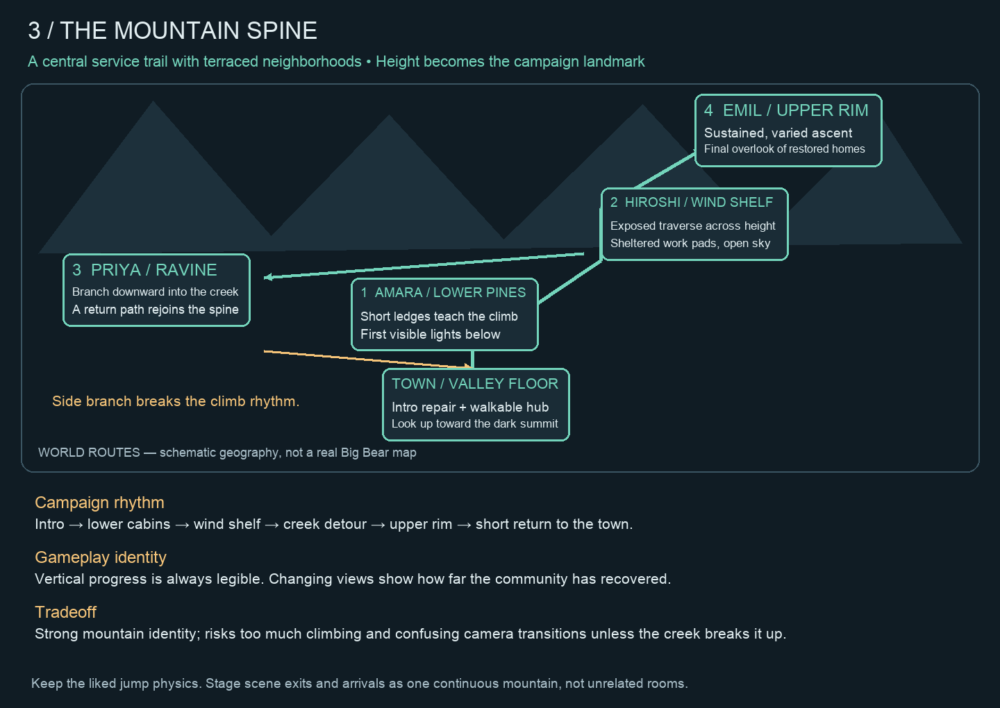
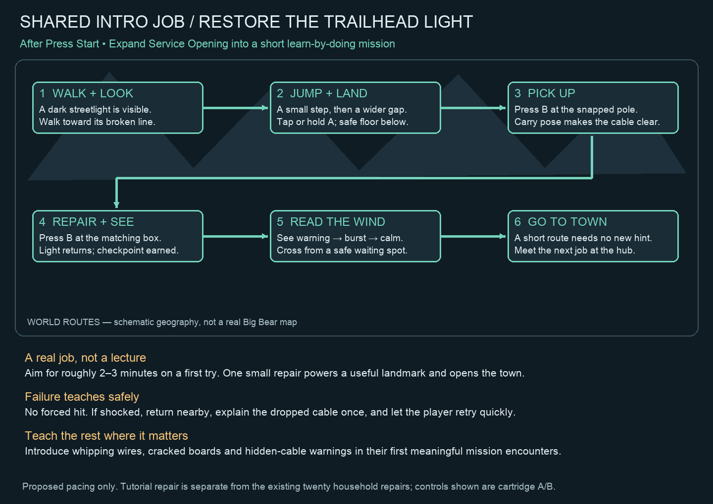

# Mountain community: three whole-game terrain proposals

November 8, 2026. Proposal only, on `feat/terrain-design`. Fictional mountain
community inspired by Big Bear: pine woods, cabins, exposed granite, creek gullies,
lake views and utility trails. These are world/route diagrams, not collision maps.
The earlier Saddle study is one local crossing example, not the scope of the plan.

## Shared design commitments

Keep the accepted jump physics, hero and art direction. Retain four households and
five repairs per main job. Include the pending walkable top-down town; repair jobs
remain platforming. Each home appears once in world geography; town trailheads
lead to those homes rather than duplicating them as destination buildings.

Terrain should explain a hazard's location: a hanging wire sweeps a service
crossing, wind affects an exposed gap, and a broken footbridge changes footing.
No low rock roofs added solely to suppress jumping. Required repair destinations
and meaningful landings make crossings relevant. A skillful jump is valid mastery.
A safe alternative needs a clear cost, such as extra travel, without punishing
players who need recovery. Keep waiting/working pads outside active hazard bounds.

Every area gets a purpose: approach, crossing, work, recovery, rest or scenic payoff.
Shorten space with no purpose instead of filling every pocket with hazards.
A typical mission rhythm is **preview → learn → combine → repair/payoff → return**.
Do not increase scene sizes uniformly: use wider scenes for traverses and tall
scenes for actual descent/ascent. Time first attempts and retries before promising
longer missions. More tiles are useful only when they support another meaningful beat.

## 1. Lakeside neighborhood — recommended

A small walkable town sits beside the lake. Signed departure paths reach four
terrain districts; job order can remain guided. After each job, a short return
path brings the player back to changed lights and a brief resident response.

| Job | Terrain and gameplay sequence | Placement principle |
| --- | --- | --- |
| Amara | Pine steps → damaged cabin walkway → first household connection | Isolate a readable wire crossing, then combine a jump with cable delivery. |
| Hiroshi | Open ridge → exposed gap → service islands → hillside home | Put work destinations on useful pads between gust crossings; leave the sky open. |
| Priya | Creek approach → visible descent → broken footbridges → porch | Preserve the liked descent; a lower path must reach a repair or provide real recovery. |
| Emil | Hollow → foreshadowed ascent → upper rim → home | Alternate climb and traverse; show the exit landmark before the scene boundary. |

Strength: strongest variety and clearest progress, with the least change to the
existing campaign structure. Risk: repetitive dispatch trips. Keep town travel
brief and show a meaningful visual change on return. Restored districts can be
visible across the lake; houses need not all sit in the town screen.

## 2. Valley restoration loop

The campaign follows one connected circuit: lower cabins, exposed high pass,
creek descent, return ridge, then town. The next destination is visible from the
previous one. The town remains walkable, but every job need not return for dispatch.

Gameplay emphasis: read the landscape and progressively reconnect the community.
Amara introduces footing; Hiroshi tests exposed traverses; Priya changes direction
and uses descent/landing decisions; Emil combines the learned skills on the return.
Electrical restoration can light a safe footpath or power a gate that opens a
shortcut. It does not magically repair a physically broken wooden bridge.

Strength: a cohesive journey with a satisfying final loop closure. Risk: extra
navigation, persistent shortcut logic and long recovery walks. Cable loss must
have local recovery; never require another lap around the valley.

## 3. Mountain spine

A central utility trail climbs through neighborhoods at different elevations.
Amara occupies the lower pines, Hiroshi an exposed shelf, Priya a ravine branch,
and Emil the upper rim. The town and restored lights remain the visual reference.

Gameplay emphasis: elevation and changing views. Short ledges grow into ridge
traverses, then Priya's descent breaks the climbing rhythm before Emil's final
ascent. Return footpaths reconnect the trunk; no new vehicle system is assumed.

Strength: strongest mountain identity and final overlook payoff. Risk: repetitive
climbing and confusing camera seams. Each new scene must continue the previous
scene's direction, footing and visible landmark, with a safe arrival before input
is needed. Do not hide the hero under HUD overlays at elevated landings.

## Shared intro: restore the trailhead light

Yes: a short playable job after Press Start is the right place to explain being a
lineman. Expand the existing Service Opening, which already follows the title,
rather than adding a second tutorial. Proposed first-try duration: 2–3 minutes,
to be measured with a new player. Its repair is separate from the twenty main-job
repairs; the depot/trailhead payoff preserves Amara as the first household reward.

1. Show the dark trailhead light and broken line as the visible objective.
2. Teach walking and A jump with a low step, then a wider gap with safe recovery.
   Let short tap versus hold emerge through play; keep the current physics.
3. Prompt B only at the first cable pickup. The Carry pose and visible destination
   explain what is happening; avoid a full controls page.
4. B at the matching box restores the light and records a checkpoint. Give success
   before introducing danger. Teach B-away-from-zone cable drop when relevant.
5. On the exit, introduce one gentle wind crossing: a safe waiting pad, visible
   warning/burst/calm, broad landing and nearby recovery. The repaired light stays
   on after failure. No forced damage and no new cable to lose here.
6. Reach town through a short unprompted section; the first signed job tests whether
   the player understands the loop.

Do not pack every hazard into this job. Introduce the first live wire in Amara's
route, alone and clearly signaled, then combine familiar challenges later.
Explain cable loss once on the first actual shock, near a quick retry. Teach
cracked boards and hidden-cable warnings at their first relevant encounters.
If the wind lesson overloads first-time players, move that beat to Amara's exit;
retain the tutorial's movement, pickup, repair and visible payoff.

## Decision and next implementation gate

Recommend **variant 1** as the whole-game structure, with the open terrain and
view continuity common to all three. These alternatives are not three production
builds. No world layout has been selected yet.

After selection, draw one side-view route sheet per household showing the easiest
route, cable/work destinations, hazards, warnings, waiting pads, recovery, camera
seams and return path. Review those before generating collision geometry. Prototype
the intro and one representative crossing, then validate both novice and skilled
routes before spreading the design across the campaign. Build/play the prepared
walkable hub as part of that selected world structure.

Read-only consultant `payoff_audit` reviewed navigation, tutorial overload and
restoration payoff. Static diagrams are visually reviewed planning evidence;
there is no new runtime, browser or hardware acceptance in this change.
